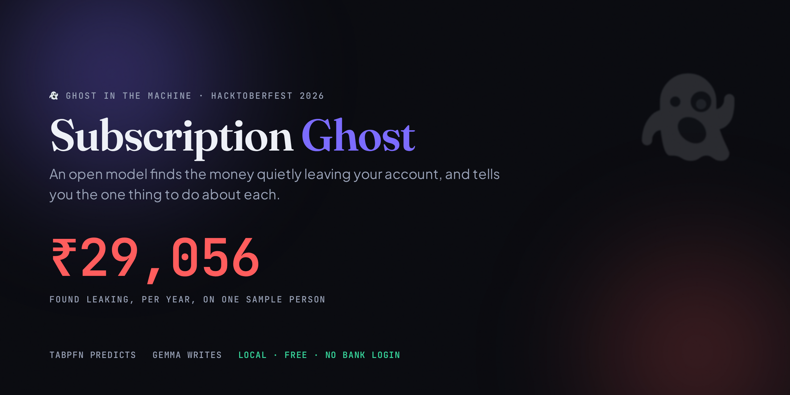
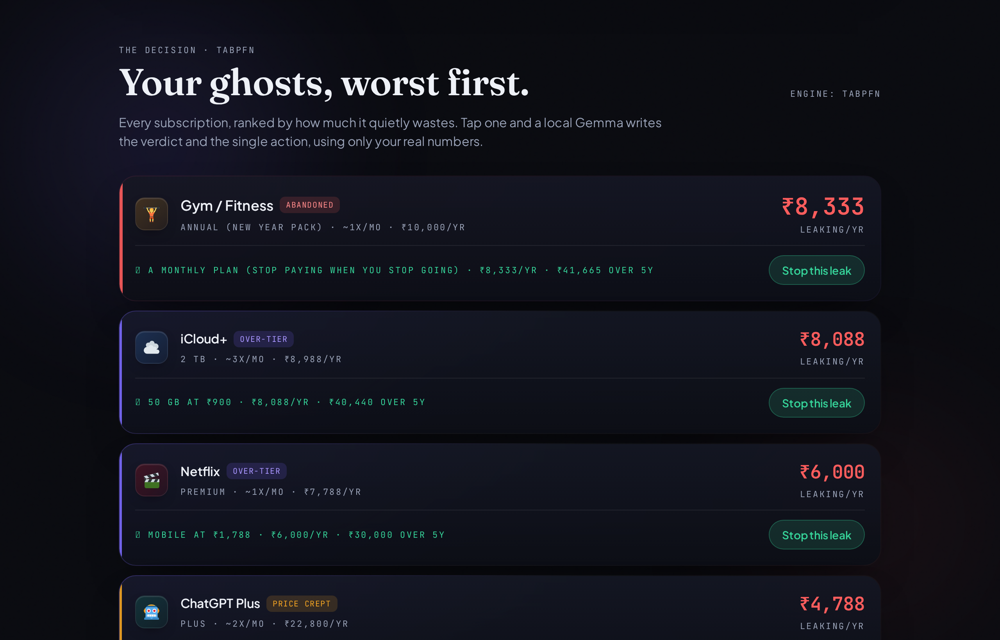
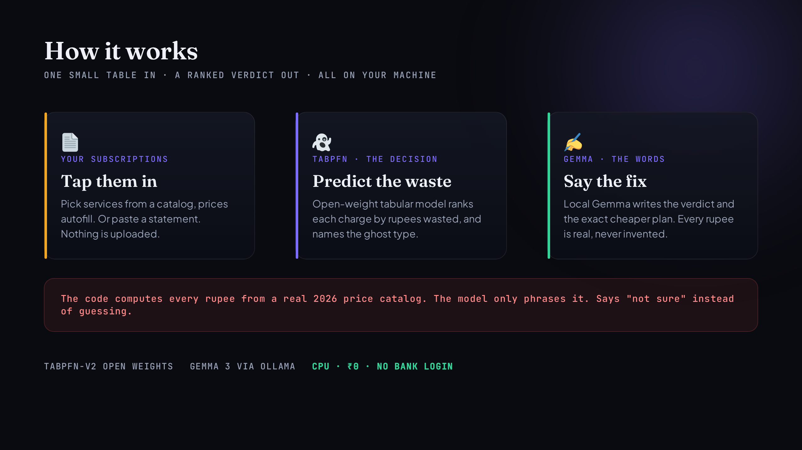

<div align="center">



# 👻 Subscription Ghost finds the money quietly leaving your account

### An open-weight model reads your subscriptions and predicts which ones are ghosts: the plan too big for how you use it, the price that quietly crept up, the gym you stopped going to in February. Then it tells you the one thing to do about each. It runs on your own laptop, for free, and never asks for your bank login.

[](https://priorlabs.ai)
[](https://ai.google.dev/gemma)
[](https://ollama.com)
[](#-getting-started)
[](#-why-open-innovation-matters)
[](LICENSE)

[](https://simplynadaf.github.io/subscription-ghost/)

**👻 Built for the [Hacktoberfest Open-Source AI Challenge Week 4: Ghost in the Machine](https://dev.to/challenges/hacktoberfest-week4-2026-10-26)**

> ### Every tracker stops at the list. Subscription Ghost predicts which ones to kill or downgrade, and shows you the exact rupees you get back.

[The One Prediction](#-the-one-prediction) · [The Four Ghosts](#-the-four-ghosts) · [How It Works](#-how-it-works) · [The Honesty Rule](#-the-rule-it-never-bends) · [Getting Started](#-getting-started)

</div>

---

<div align="center">

### The verdict, inside Subscription Ghost's own UI

<em>TabPFN ranks every subscription by how much it quietly wastes (the decision). Tap one and a local Gemma writes the verdict and the single action, using only your real numbers (the words).</em>



</div>

---

**📖 Table of Contents**
- [The Problem (the charges designed to be invisible)](#-the-problem)
- [The One Prediction](#-the-one-prediction)
- [The Four Ghosts](#-the-four-ghosts)
- [Why Predicting Beats Listing](#-why-predicting-beats-listing)
- [How It Works](#-how-it-works)
- [The Rule It Never Bends](#-the-rule-it-never-bends)
- [An Honest Scorecard](#-an-honest-scorecard)
- [Lazy by Design](#-lazy-by-design)
- [Tech Stack](#️-tech-stack)
- [Getting Started](#-getting-started)
- [Proof It Works](#-proof-it-works)
- [Project Structure](#-project-structure)
- [Why Open Innovation Matters](#-why-open-innovation-matters)
- [An Honest Take](#-an-honest-take)
- [FAQ](#-faq)
- [License](#-license)

---

## 🤔 The Problem

Recurring charges are designed to be invisible. Each one is small enough that you never
notice it alone, and it blends into the noise of your statement. Your bank will not flag
them, because you authorized them.

The numbers are not small when you add them up. A 2026 survey found 59.9% of people have at
least one unused subscription, wasting around $26.79 a month, roughly $321 a year. Another
found people estimate they pay $86 a month and actually pay $219: a 2.5x blind spot. In
India it looks like an Airtel plan that bundles full Amazon Prime (₹1,499 a year) when you
only ever use it for shipping, or a New Year gym membership paid a year up front that you
stopped using by March, like 80% of people do.

Every tool that tries to help does the same thing: it **lists** your subscriptions. As one
2026 roundup put it, "most trackers stop at the list. The cancelling is still your job."

> So Subscription Ghost does the part they skip: it **predicts** which charges are quietly
> wasting money, ranks them worst first, and tells you the single thing to do about each,
> with the rupees you get back.

---

## 👻 The One Prediction

You give it your subscriptions (tap them from a catalog, the price fills in). Each is a
small row: what you pay, how often you really use it, how long you have had it, whether the
price crept up, whether you paid a year in advance.

**TabPFN-v2**, Prior Labs' open-weight tabular foundation model, reads that small table and
predicts the **rupees each one wastes per year** in a single forward pass, with no training
loop of its own. Then it ranks them. The top of the list is what to cancel or downgrade
first. **Gemma 3**, running locally through Ollama, writes the plain verdict and the exact
action for each.

---

## 👻 The Four Ghosts

Subscription Ghost does not just say "wasted". It names **why**, so the action is specific:

| Ghost | What it means | Real example |
|---|---|---|
| **Over-tier** | You use one slice of a bundle; a cheaper tier covers your real use | Airtel bundles full Prime (₹1,499/yr); you only use shipping; Prime Shopping Edition (₹399/yr) covers that. **₹1,100/yr ghost.** |
| **Abandoned** | Paid a year up front, then stopped showing up | New Year gym pack (~₹10,000); 80% quit by March; the rest is a ghost |
| **Dead** | Paying, barely opening it | Netflix Premium watched once a month |
| **Price crept** | The price quietly rose and you never noticed | A plan that went from ₹9.99 to ₹16.99 |

---

## 🧠 Why Predicting Beats Listing

| | Subscription trackers (the crowd) | Subscription Ghost |
|---|---|---|
| What it does | lists your recurring charges | **predicts which ones waste money** |
| Where you start | a list and good intentions | a worst-first ranked verdict |
| Uses the model for | nothing (regex / clustering) | a genuine tabular **forecast** (TabPFN) |
| Tells you the action | "the cancelling is your job" | the exact downgrade or cancel, with the saving |
| Bank login | usually required (Rocket Money) | **never** |
| Honest about being wrong | rarely | a held-out scorecard, misses included |

---

## 🧠 How It Works

<div align="center">

</div>

```
 🧑 Your subscriptions (tap from a catalog, price autofills; or paste a statement)
      │
      ▼
 👻 TabPFN-v2  (open weights, CPU, one forward pass)        the DECISION
      │   predicts rupees wasted per year, ranks worst first
      │   a transparent rule tags each ghost type (over-tier / abandoned / dead / crept)
      ▼
 ✍️ Gemma 3 via Ollama  (open weight, local, CPU)          the WORDS
      │   writes the verdict and the one action, using ONLY your real numbers
      ▼
 🔎 the no-invented-numbers check  →  strips any rupee figure not in your data
      │
      ▼
 📜 a worst-first list of ghosts + the rupees you get back
```

- **`ghost/catalog.py`** holds real 2026 service tiers (Prime, Netflix, JioHotstar, Spotify,
  gym, and more) so prices and cheaper-tier suggestions are real, never invented.
- **`ghost/predict.py`** is the heart: TabPFN fits on a labeled log, predicts waste, ranks,
  classifies the ghost type, and reports an honest held-out scorecard. Deterministic fallback.
- **`ghost/remember.py`** asks a local Gemma for the verdict and action, then strips any
  rupee number it invented. Deterministic template when Ollama is off.
- **`ghost/api.py`** is a small FastAPI app wiring it together and serving the UI.

---

## 🚫 The Rule It Never Bends

A tool about money cannot invent money. So **the code computes every rupee; Gemma only
phrases it.** Gemma is given your real numbers and is forbidden from inventing any price,
rupee figure, or tier that is not supplied. Every number it writes is checked against the
numbers we gave it, and a line that smuggles in a figure we never provided is stripped and
reported. When the model is unsure, the honest move is to say so, not to guess.

---

## ✅ An Honest Scorecard

Because this is a prediction, it can be wrong. Subscription Ghost fits TabPFN on 75% of the
subscriptions and scores itself on the 25% it never saw:

```
scorecard (held-out, synthetic subscriptions)
  engine:              tabpfn
  holdout_count:       100
  mae_rupees:          523     # waste prediction lands within ~500 rupees
  rank_correlation:    0.971   # the worst-first ORDER is what matters, and it is strong
  precision_at_k:      0.85    # of the 20 it flags most wasteful, 17 are truly in the top tier
  rupees_captured_pct: 96      # its top flags capture 96% of the real rupee waste
  missed:              3       # and it still MISSES 3 real ghosts. that is the honest cost.
```

The data is **synthetic and labeled as such** (there is no public dataset of "which of your
subscriptions you secretly do not use"), but the **prices are real 2026 catalog prices**.
The score measures the model's ability to learn a waste pattern, exactly as it would learn
yours from your real log. Regenerate and re-score any time:

```bash
python scripts/build_dataset.py
python ghost/predict.py
```

---

## 😴 Lazy by Design

People are lazy, and a money tool that needs a tedious form gets abandoned. So:
- **See value with zero input.** It opens on a real sample person's subscriptions, showing
  the ghosts immediately.
- **Tap, do not type.** Add a subscription by tapping its logo tile; the price and tiers
  fill in from the catalog. Then one tap for how often you really use it.
- **Paste a statement (optional).** Nothing is uploaded; detection runs on your device.
- **No bank login, ever.** The opposite of Rocket Money.

---

## 🛠️ Tech Stack

| Component | Technology |
|---|---|
| 👻 The prediction | **TabPFN-v2** (Prior Labs, open weights), tabular foundation model on CPU |
| ✍️ The words | **Gemma 3** (Google open weight) via [Ollama](https://ollama.com), local on CPU |
| 🧱 Backend | FastAPI + Uvicorn |
| 🎨 UI | single-file, Tailwind + GSAP, Apple-grade dark finance aesthetic, mobile and tablet |
| 🛟 Never hard-fails | a deterministic fallback for both the prediction and the writing |
| ✅ Checks | `scripts/validate.py`, assert-based, no server and no GPU needed |

Everything runs on a plain CPU. No GPU, no API key, no account, no bank login.

---

## 🚀 Getting Started

```bash
# 1. install (CPU only)
python3 -m venv .venv && source .venv/bin/activate
pip install -r requirements.txt

# 2. a local Gemma for the verdict text (optional; falls back cleanly without it)
ollama pull gemma3:1b

# 3. build the synthetic log and check the whole pipeline
python scripts/build_dataset.py
python scripts/validate.py          # asserts end to end, no server needed

# 4. run it
python run.py                       # http://127.0.0.1:8080
```

**Prerequisites:** Python 3.9+ and about 2 GB of disk for the models. TabPFN downloads its
open weights once, then runs offline.

---

## ✅ Proof It Works

Validated end to end on a plain CPU box (8 vCPU, no GPU):

```
$ python scripts/validate.py
catalog ok: Prime over-tier ghost = 1100/yr (1499 vs 399)
scorecard: {'engine': 'tabpfn', 'mae_rupees': 523, 'rank_correlation': 0.971,
            'precision_at_k': 0.85, 'missed': 3, 'rupees_captured_pct': 96}
ranking ok, engine=tabpfn, ghost types present: ['abandoned', 'crept', 'dead', 'over-tier', 'worth-it']
verdict ok, writer=gemma, removed=0

ALL CHECKS PASSED
```

On the sample person, it finds the Airtel-bundled Prime as an **Over-tier** ghost, the New
Year gym as **Abandoned**, and correctly leaves the daily-used services alone.

---

## 📁 Project Structure

```
subscription-ghost/
├── README.md
├── LICENSE                     # MIT
├── requirements.txt
├── run.py                      # one-command entry point
├── ghost/
│   ├── catalog.py              # real 2026 service tiers + over-tier detection
│   ├── predict.py              # ★ TabPFN waste engine + ghost types + honest scorecard
│   ├── remember.py             # Gemma verdict writer + the no-invented-numbers rule
│   └── api.py                  # FastAPI: health / catalog / analyze / verdict / scorecard
├── data/
│   └── subscriptions.csv       # synthetic log, real prices; regenerate with build_dataset.py
├── scripts/
│   ├── build_dataset.py        # transparent synthetic-subscription generator
│   ├── validate.py             # assert-based end-to-end check (no server, no GPU)
│   └── bake_static.py          # freeze a judge-proof static demo for GitHub Pages
└── web/
    ├── index.html              # the Apple-grade UI (verdict, ghost list, add sheet)
    └── assets/                 # baked demo data
```

---

## 💡 Why Open Innovation Matters

**Because a tool that finds money leaks should not be one.** Rocket Money and the rest ask
to link your bank and then watch every transaction you make, forever, and many charge a
subscription to do it. Subscription Ghost runs TabPFN and Gemma on your own machine, on open
weights, for ₹0. It reads only what you tell it and uploads nothing. No bank login, no
account, no bill.

**Because it cannot be taken away.** Open weights on your own disk do not get sunset or
locked behind a new paywall. The tool that saves you money will not one day start costing it.

**Because you can see it be wrong.** Open means the held-out scorecard is right there, misses
included, and every rupee in the verdict is computed in code you can read, not conjured by a
model you cannot inspect.

---

## 🧾 An Honest Take

**What is genuinely strong**
- The AI is load-bearing: TabPFN's ranked waste prediction is the product, not decoration.
- The scorecard reports what it gets wrong (`missed: 3`), not a vanity metric.
- Prices are real and cited; the no-invented-numbers rule is enforced in code and tested.

**Honest limits**
- The training data is **synthetic** (no ground-truth dataset for personal waste exists), so
  the score measures pattern-learning. The prices it reasons over are real.
- Catalog prices change; they were read from public sources in October 2026 and will drift.
- Gemma 3 1B is small, so its verdicts are kept short and number-bound; the deterministic
  writer is often sharper and is used as the floor.

**Lineage, disclosed.** This reuses an engine pattern I have shipped before in this challenge
series (FrostWise, PricePilot, Unpile): an open-weight predictor paired with a local Gemma
writer and a deterministic fallback. New project, new repo, new idea, built fresh in the
Week 4 window.

---

## ❓ FAQ

**Is the prediction real or a prompt trick?**
Real. TabPFN-v2 (open weights) predicts the rupees each subscription wastes. Gemma only
writes the human sentence for the ones it ranks highest.

**Do you see my bank account?**
No. There is no bank login anywhere. You tap services from a catalog or paste text locally.
TabPFN and Gemma run on your machine. Nothing is uploaded.

**Is the data real?**
The prices are real 2026 catalog prices. The training log is synthetic and labeled as such,
because no public dataset of personal subscription waste exists.

**Does the live demo cost anything?**
No. It is a static replay of a real run, baked to GitHub Pages, making zero calls.

---

## 🔗 Links

- 👻 Challenge: https://dev.to/challenges/hacktoberfest-week4-2026-10-26
- 🖥️ Live demo (static replay): https://simplynadaf.github.io/subscription-ghost/
- ▶️ Demo video: coming soon

---

## 📝 License

MIT. See [LICENSE](LICENSE).

---

<div align="center">

## 👨‍💻 Author

**Sarvar Nadaf** · Cloud Architect · AI Infrastructure & DevOps

[Portfolio](https://sarvarnadaf.com) · [LinkedIn](https://www.linkedin.com/in/sarvar04/) · [GitHub](https://github.com/simplynadaf) · [Dev.to](https://dev.to/sarvar_04) · [YouTube](https://www.youtube.com/@sarvar-nadaf) · [AWS Builder Center](https://builder.aws.com/community/@sarvar)

*Open models, on your own laptop: TabPFN predicts the waste · Gemma writes the verdict · no bank login, nothing uploaded*

**If this found a ghost in your own subscriptions, consider a ⭐**

</div>
